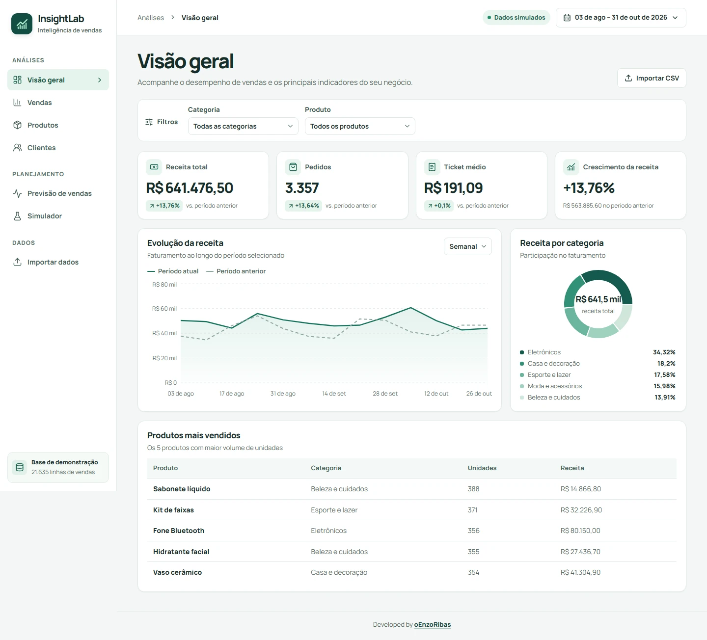
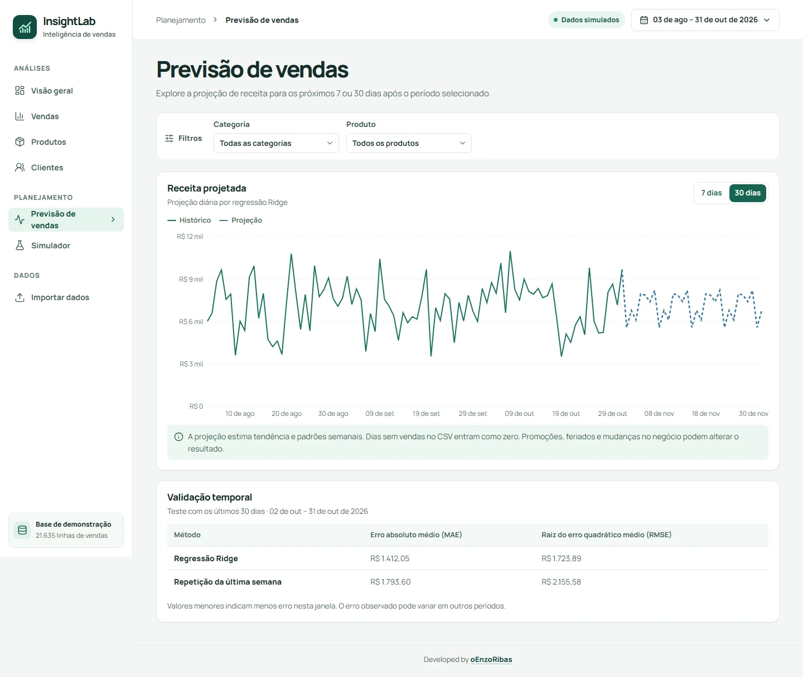
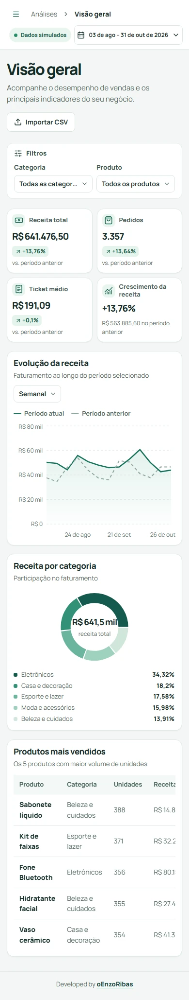
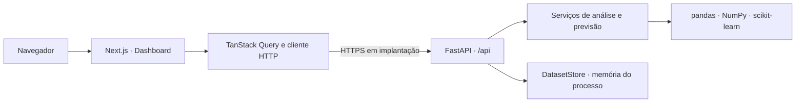

# InsightLab


Projeto desenvolvido com apoio de inteligência artificial para o **portfólio da CODE JR**.

**Inteligência de vendas para varejo.** O InsightLab transforma um histórico de vendas por item em uma visão de receita, produtos e clientes. Comece pela demonstração, com 18 meses de dados sintéticos, ou explore um CSV com o mesmo formato. Os cálculos são executados na API Python e podem ser conferidos pela documentação interativa.



| Recurso | O que permite investigar |
| --- | --- |
| Visão geral e vendas | Receita, pedidos, ticket médio, crescimento e comparação com o período anterior. Agrupamento diário, semanal ou mensal e filtros por data, categoria e produto. |
| Produtos | Unidades vendidas, receita por categoria, ranking, variação e curva ABC de faturamento. |
| Clientes | Clientes únicos, recorrência, frequência, gasto médio e segmentos por número de pedidos. Requer identificadores anônimos. |
| Previsão | Projeções diárias de 7 ou 30 dias quando há histórico suficiente, com métricas de erro e um baseline sazonal. |
| Simulador | Efeito hipotético de alterações do volume, do crescimento e do ticket médio sobre a receita. |
| Importação | Validação de CSV, modelo de arquivo e análise temporária na mesma aplicação. |

[Galeria desktop e mobile](docs/screenshots/README.md) · [Documentação técnica](docs/README.md) · [Metodologia dos indicadores e da previsão](docs/metodologia.md)

<details>
<summary>Ver a previsão de vendas e o painel mobile</summary>





</details>

## Arquitetura



O Next.js entrega a página e o navegador consulta diretamente a FastAPI. A API valida os recortes, seleciona a base e calcula os resultados. O armazenamento em memória atende à demonstração e às sessões temporárias de importação. [Arquitetura detalhada e diagramas](docs/architecture.md)

| Diretório | Responsabilidade |
| --- | --- |
| `frontend/app`, `features` | App Router, layout e telas do painel. |
| `frontend/components`, `hooks`, `lib`, `types` | Componentes shadcn/ui, Recharts, Lucide, consultas, formatação e contratos TypeScript. A interface usa Tailwind CSS e Manrope. |
| `backend/app/api`, `schemas` | Rotas FastAPI e contratos Pydantic. |
| `backend/app/services`, `models`, `core` | CSV, indicadores, modelo Ridge, armazenamento temporário e configuração. |
| `backend/data`, `tests` | Gerador sintético reproduzível e testes pytest. |
| `docs`, `.github` | Documentação, diagramas, capturas, formulários e validações de CI. |

## Executar localmente

Use **Node.js 24**, **npm 11** e **Python 3.14**, que correspondem ao ambiente de validação. O clone requer acesso ao repositório.

```sh
git clone https://github.com/oEnzoRibas/InsightLab.git
cd InsightLab
```

Em dois terminais, a partir da raiz do repositório:

**API · PowerShell**

```powershell
cd backend
python -m venv .venv
.\.venv\Scripts\python.exe -m pip install -r requirements-dev.txt
.\.venv\Scripts\python.exe -m uvicorn app.main:app --reload --no-access-log
```

**Frontend**

```sh
cd frontend
npm ci
npm run dev
```

Abra [localhost:3000](http://localhost:3000) e consulte a API em [localhost:8000/docs](http://localhost:8000/docs). Os exemplos de configuração estão em [`frontend/.env.example`](frontend/.env.example) e [`backend/.env.example`](backend/.env.example). O [guia de instalação](docs/getting-started.md) inclui Linux/macOS, configuração de portas, geração do CSV sintético e teste rápido.

## Desenvolvimento e qualidade

| Camada | Comandos dentro do diretório |
| --- | --- |
| Frontend | `npm run lint`, `npm run typecheck`, `npm run build` |
| Backend | `python -m ruff check .`, `python -m pytest -q` no ambiente virtual |
| Docker | `docker build -t insightlab-api ./backend` a partir da raiz |

Mantenha regras de negócio e contratos no backend e use os componentes compartilhados do frontend para apresentar os dados. Mudanças nos contratos precisam ser refletidas nos tipos TypeScript e verificadas nos testes da API. [Guia de desenvolvimento](docs/development-guide.md) · [Cobertura e comandos de teste](docs/testing.md) · [Referência HTTP](docs/api-reference.md)

A configuração de implantação prevê um frontend Vercel e uma API Python em contêiner. Veja as variáveis, a checagem de saúde e o requisito de instância única no [guia de implantação](docs/deployment.md).

## Segurança e limitações

A API limita e valida uploads, aplica CORS por origem e usa `Cache-Control: no-store`. Uma importação dura até 30 minutos e fica na instância que a recebeu. A chave temporária permite acessar e excluir a base associada. Use arquivos fictícios ou anonimizados. [Modelo de segurança](docs/security.md) · [Reporte privado](SECURITY.md)

A cobertura de clientes depende da identificação dos pedidos. A comparação exige uma janela anterior completa. A projeção assume continuidade da tendência linear e do padrão semanal e pode errar em promoções, feriados ou períodos com dados incompletos. O simulador aplica as premissas escolhidas pelo usuário. [Metodologia](docs/metodologia.md)

### Roadmap proposto

- Cobrir no navegador os fluxos de filtros, importação e expiração da sessão.
- Avaliar estabilidade da previsão com várias janelas temporais.
- Definir controles de acesso e armazenamento antes de oferecer importação de dados empresariais em uma implantação multiusuário.

## Contribuição e licença

Consulte [CONTRIBUTING.md](CONTRIBUTING.md), [Código de Conduta](CODE_OF_CONDUCT.md) e [Histórico de mudanças](CHANGELOG.md). A [proposta de licença MIT](LICENSE.proposed) aguarda confirmação de titularidade e aprovação. A adoção da licença será registrada no repositório quando essas condições forem atendidas.

## Desenvolvedor

**Developed by oEnzoRibas**

**oEnzoRibas** é o desenvolvedor creditado no InsightLab e a referência indicada para sua manutenção. GitHub · [@oEnzoRibas](https://github.com/oEnzoRibas)
