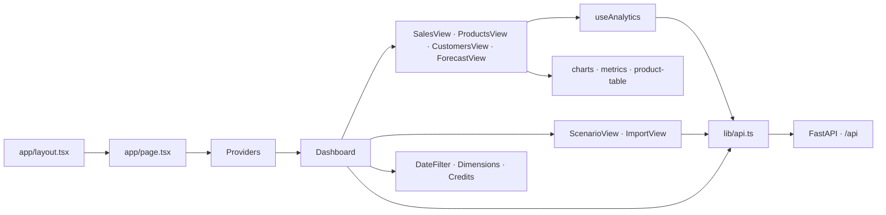
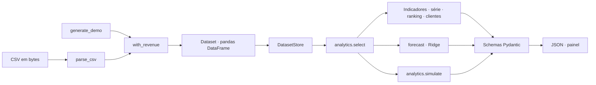
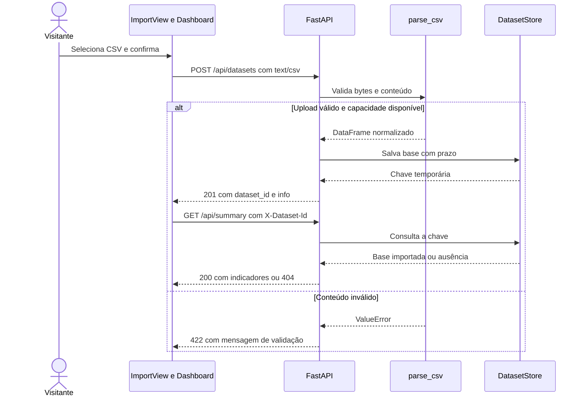
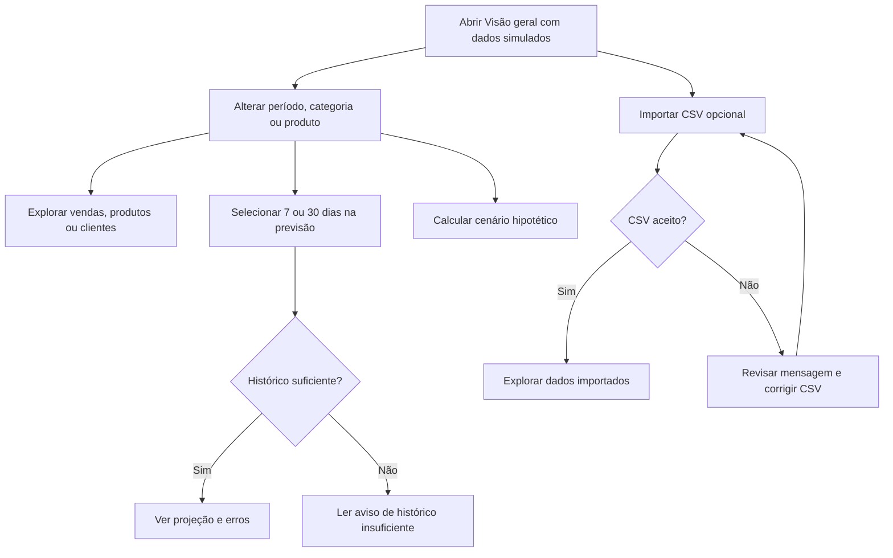
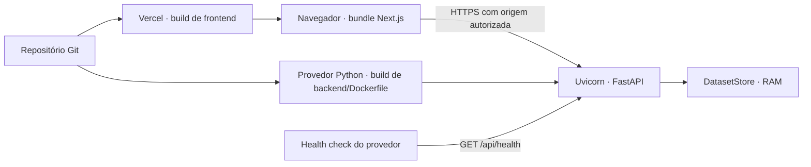

# Diagramas

## Arquitetura geral

Veja o [diagrama do README](../../README.md#arquitetura). Ele mostra a consulta direta do navegador à API e o armazenamento no processo Python.

## Componentes

O painel controla a seção, os filtros e a base. As features reutilizam as consultas e primitivas visuais. O único caminho HTTP parte do cliente do navegador.

## Dados

A importação e a demonstração convergem no mesmo DataFrame. A receita em centavos é derivada antes da análise.

## Sequência da importação

A interface troca a fonte após validação. A chave é uma credencial temporária de posse, associada ao processo que aceitou o upload.

## Jornada do visitante

A fonte selecionada permanece ao trocar de seção. Um upload bem-sucedido redefine o intervalo para a nova base.

## Implantação

O diagrama representa a topologia configurada para implantação. O frontend é entregue pela Vercel e a API roda em um serviço Python com um processo e uma réplica. A infraestrutura precisa ser provisionada antes de disponibilizar uma demonstração online.

O sistema usa o DataFrame descrito no [fluxo de dados](../data-flow.md) e a chave temporária descrita em [segurança](../security.md). Diagramas relacionais e de autenticação de contas ficam fora do escopo da arquitetura atual.
