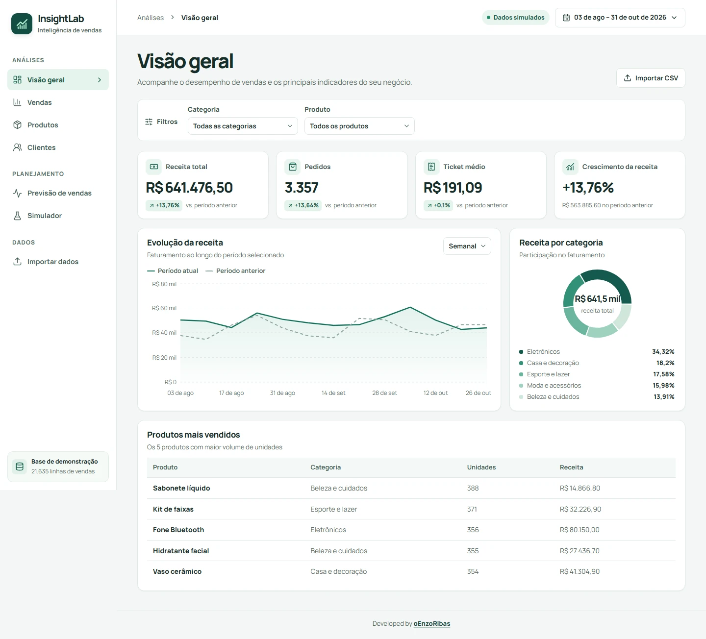
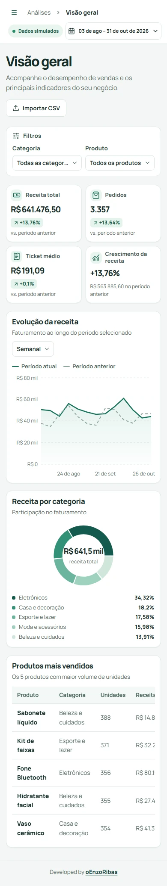

# Capturas do InsightLab

Capturas da aplicação local com a API ativa e a base sintética. Os dados, gráficos e estados abaixo vêm da interface em execução.

## Visão geral

### Desktop

### Mobile

## Análises e planejamento

| Tela | Captura |
| --- | --- |
| Vendas com filtro de eletrônicos | [Série temporal e comparação](vendas-filtradas.webp) |
| Produtos | [Curva ABC e desempenho por produto](produtos-abc.webp) |
| Clientes | [Recorrência, frequência e segmentos](clientes-segmentos.webp) |
| Previsão | [Histórico, projeção de 30 dias e métricas de validação](previsao-30-dias.webp) |
| Simulador | [Premissas e faturamento hipotético](simulador-cenario.webp) |
| Importação | [Interface de importação e validação de um CSV fictício](importacao-csv.webp) |
| Histórico insuficiente | [Estado da previsão para uma janela curta](previsao-historico-insuficiente.webp) |

Para atualizar a galeria, inicie a [aplicação e a API localmente](../getting-started.md). Capture a página com os dados carregados, use apenas a demo ou um arquivo fictício, inclua uma viewport mobile e salve em WebP. As capturas completas incluem conteúdo abaixo da primeira dobra.
